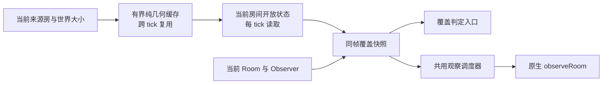

# CPU 与架构优化第二轮：v25 发布与实测

本轮从当前线上 v24 的 CPU 数据出发，减少 PowerBank 搜索与 Observer 覆盖检查的重复计算。改动限于两个运行时模块及其回归测试，没有调整主循环顺序、角色寻路、战斗编制或市场写入策略。

## 当前基线与范围

- 账号：forster；目标：screeps.com/default/shard1。
- 基线源码：`bb207aacf618c78377b093e130993b2d081b9cca`。
- 基线版本：`2026.10.5-5+bb207aa@2026-10-04T20:39:11.972Z`。
- 基线 bundle SHA-256：`ccdf5ea1c8b661a2a5a1af747b8141bc236ed3d5dfcc3177164ac97391de5f5d`，3,616,359 字节。
- 候选源码：`b6d065372d83c3f442411aa917b25501e4f4c9f0`，包版本 `2026.10.5-6`。
- 代码目录：`/Users/forst/code/screeps/.codex/worktrees/architecture-cpu-round1`。根目录源码与线上版本不同，未用根目录构建或上线。
- 所有类型检查、测试、构建和性能对照均在 dsh 的 `/srv/screeps-treasury-build/architecture-cpu-round2-20261005/candidate` 执行；本机仅编辑、轻量汇总、传输与发布控制。

## 计算边界的调整

`powerBankSearch.ts` 将数学上确定的高速房候选集合，从每帧的开放房间过滤中拆出。跨 tick 的私有缓存只保存纯几何结果，完整键包含搜索半径、来源房和世界大小，最多 32 项；缓存数组冻结，返回给调用方的数组仍是独立副本。每 tick 继续通过当前 `Game.map.getRoomStatus` 核对开放状态，不缓存跨帧的原生事实。当前来源房名单、归属和 RCL 仍重新读取。

`powerBankObserver.ts` 让覆盖判定入口与观察调度共用同帧的私有覆盖快照。快照绑定 Game、tick、运行时服务、Observer 集合和候选值；公开 Memory 中的覆盖列表写入副本，调用方改动它不能污染内部覆盖证明。原有可达性缓存已经在同帧复用，因此移除了调度器内重复的可达性 Map。

Observer 列表复用时还会核对当前 Room 对象和房间归属。Room 被替换、失去归属、tick 变化或服务替换时重建快照。原生结构活动状态仍按每帧规则读取。

保持 PowerBank 每房约 500 tick 的常规巡查、TooAngel 三个清剿房间每 100 tick 的观察、显式 fresh 请求优先级、同房去重和每个 Observer 每 tick 最多一条观察意图。未修改 Memory 声明或黄金样本，没有增加公开全局入口。

同一输入的计算与原生事实读取形成两个明确的生命周期边界：

## 对照验证

服务器用线上 v24 的原始 Observer/Search 源码作为基线，仅将基线 Observer 的 Search 导入重定向至基线文件。候选直接引用当前候选模块。两者使用相同的运行时上下文和输入；输出摘要覆盖每帧观察发布、覆盖结果与 Observer Memory。对照环境为 Node + Jest，原生房间状态、距离、结构查询与 observeRoom 使用确定性的 API 桩；实际游戏 CPU 由下一节线上采样衡量。

输入为 8 个源房、108 个开放高速房、600 帧。600 帧跨过第二轮常规巡查；包含自然视野、三房清剿观察、PowerBank/Deposit/外矿观察请求、来源房归属暂时丢失、房间暂时关闭及 Observer 暂时失效。进行了 5 次对照，交替旧版与新版执行顺序。

| 指标 | v24 | 候选 |
|---|---:|---:|
| 600 帧执行时间中位数 | 4,185.45 ms | 705.07 ms |
| 几何分类调用，后四次每次 | 2,112,948 | 4,968 |
| getRoomStatus 模拟调用，每次 | 85,200 | 85,200 |
| 原生距离 API 模拟调用，每次 | 159,088 | 159,088 |
| 结构查询模拟调用，每次 | 4,780 | 4,780 |
| observeRoom 模拟调用，每次 | 302 | 302 |

5 次对照的逐帧输出摘要均相同，且没有重复 Observer 发布或重复目标发布。查询部分的 Node 耗时中位数降低 83.15%；这只描述该服务器对照组件，不能当作全游戏 CPU 的降幅。

初步验证：双类型检查通过；8 套定向回归共 108 项通过；A/B 对照通过。新增回归覆盖纯几何缓存淘汰、开放状态重新读取、公开数组污染、跨 tick 距离变化、同 tick Room/Observer 替换及归属变化。

全量验证完成：237 套、1,699 项测试全部通过，无失败或跳过；双类型检查、Rollup 构建通过。服务器验证回执绑定源码 commit 与 tree，A/B 结果和基线文件也分别绑定 SHA-256。发布前检查限定除文档外仅六个已审阅文件变更。

## 原生 CPU 数据

原有 profiler 配置为启用、每 7 tick 采样、保留 120 项，本轮没有重置或改变它。临时启用现有市场细分诊断，仅改变诊断开关，窗口后已恢复 `{enabled:false, windowTicks:60}`。

市场诊断使用本轮开始和结束计数之差，排除了旧累计数据。61 个实际测量 tick 中有 12 个规划 tick；`v3Reconcile` 平均约 12.82 CPU/tick，是市场预检的主要成本。本轮保留其核验路径，未改 Treasury 或市场权限、交易通道、写入开关。

上线前首次稳定基线，tick 74128411–74128880，共 68 项：平均总 CPU 84.75，Observer 8.84，市场预检 13.08，PowerBank 调度 7.06，creep 执行 25.14；平均 creep 数 69.43，固定动作计数 62.87；最低 bucket 9872。已排除诊断窗口及其后一个采样间隔。

正式对照使用发布前最近 40 个样本（tick 74128733–74129006）与上线后保存的 17 个稳定样本。上线后样本分为 74129048–74129125（12 项）与 74129202–74129230（5 项）两个区间，排除了部署后前 14 tick，以及新 heap 历史首 tick 后的前 14 tick；缺失区间不插值。原生游戏负载没有固定，以下为观察到的窗口差值：

| 指标 | 发布前 | 发布后稳定样本 |
|---|---:|---:|
| 平均总 CPU | 83.22 | 84.64 |
| 平均 Observer CPU | 8.71 | 6.47 |
| 平均市场预检 CPU | 13.04 | 15.63 |
| 平均 PowerBank 调度 CPU | 5.53 | 7.00 |
| 平均 creep 执行 CPU | 26.31 | 24.85 |
| 平均 creep 数 | 68.62 | 69.29 |
| 平均固定动作计数 | 62.77 | 62.65 |

Observer 平均成本降低 25.69%（每 tick 约 2.24 CPU），中位数从 7.60 降至 5.95。平均总 CPU 没有下降，市场预检及规划峰值仍有波动；这轮证据支持 Observer 查询优化收益，不能证明整个 bot 的 CPU 均值已降低。

之后观察到 profiler 历史重新开始，tick 74129181 仅有 1 项，末次完整历史从 74129188 开始。发布标签、lastDeployAt 与 CPU 配置保持一致，本轮没有发出重置操作；源码的 resetCpuMonitorStore 没有生产调用。现象与全局堆重启一致，具体引擎触发原因未确定。74129181 首项总 CPU 142.538、bucket 9669 单独保存，不并入稳定均值。末次原生堆快照 tick 74129236：used_heap_size 169,021,944，heap_size_limit 775,946,240，externally_allocated_size 46,325,817 字节；该快照用于留证，不能判定重启原因。稳定样本仍较少，不能从这次观察保证长期降幅。

## 发布核验与证据

v25 包已由服务器生成并冻结：

- 发布标签：`2026.10.5-6+b6d0653@2026-10-04T21:53:16.838Z`。
- 源码 tree：`282d7974b066fc8e25955af73127faefb5326f5d`。
- bundle SHA-256：`1210b1802d65eaa2bdb5453713eb387c37c93768efb4f4e7de0c2c0a154b7540`，3,617,595 字节。
- 发布前核对账号、线上 v24 指纹、四个 shard 的 Memory、Treasury 当前责任状态以及三房共用小队/100 tick 观察配置。
- 单次上传返回 accepted；独立 code GET 回读的 SHA-256 和字节数与冻结包一致。

游戏原生日志 tick 74129033 确认 v25 标签已生效；108 个高速房均有巡查期限，过期待观察房间为 0，下一次期限分布为 5–500 tick。三个 TooAngel 目标的 lastSeenAt 均为 74129020，下一次观察期限为 74129119，100 tick 的重建观察继续运行。PowerBank 实际攻击任务和必要观察请求也保留。

服务器证据目录：`/srv/screeps-treasury-build/architecture-cpu-round2-20261005/evidence`。

本机公开证据目录：`/Users/forst/Downloads/screeps-cpu-architecture-round2-20261005`，含发布清单、校验工具、全量/定向测试日志、构建日志、A/B 输入与结果、原生 CPU 汇总。发布前的完整代码与四个 shard 的 Memory 单独存入目录权限 0700、文件权限 0600 的审计目录，不进入 Git 或公共报告。

## 后续架构判断

本轮证明：纯几何结果适合有界跨 tick 复用；涉及 Game、Room、Observer 和原生房间状态的事实应保留同帧边界与失效条件。未来处理市场 V3 核验成本时，需要先区分可以复用的纯数据转换与必须当帧读取的许可/额度/订单事实，沿用输出等价验证；不能为了降低 CPU 延长写入许可的有效期。

市场代码已经有 `MarketTickSession`，用于让 preflight 与 ResourceControl 之后的 automation 共享同 tick 的 V3 对账结果，市场 data 根替换时失效。这次诊断的 61 个 tick 对应 61 次 `v3Reconcile` 调用，主要成本来自每 tick 首次核验；再增加一层同帧 memo 不能解释或消除这部分成本。下一轮应先细分 activation、readiness、scope 与 canonical 证据处理的实际耗时，再对其中确定的纯转换做对照；现有每 5 tick 市场规划分频和每 tick 安全核验承担不同职责。

最终 Memory API 复核：Observer runtime tick 74129201，108 房均已排期、过期任务 0；三个清剿房间 lastSeenAt 均推进至 74129120，下一次观察期限 74129219。三房共用小队配置仍为 true、周期 100；没有新增补剿触发，市场诊断开关保持关闭。独立 code GET 再次确认线上指纹仍与 v25 冻结包一致。
