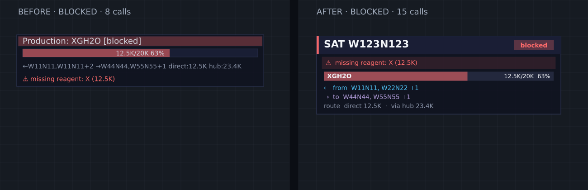

# 卫星房面板 v3 验证

日期：2026-10-17（Asia/Shanghai）。基于 `4bdb6b38` 整合用户提供的 v3 补丁；v3 已包含 v2 的卫星房样式，并扩大面板数量及总绘图预算。保留前一轮主面板工厂缺料独立成行的修复。

## 改动与预算

卫星房使用 `SAT 房间名` 标题、阶段徽标、阻塞提示及生产进度条。上游、下游分行并按房间去重，最多展示两个名称，余项显示数量；另列直供和经 Hub 分配数量。最多绘制 24 个卫星面板，总预算为 450 次 RoomVisual 调用，继续优先展示阻塞房间。

`Card.pendingCalls` 根据实际缓冲指令计算费用；输出前检查预算，通过后直接输出同一个卡片，避免预测与绘制分别拼装。默认关闭、bucket 至少 8,000 和到期停止逻辑继续生效。

## 服务器验证

构建前的双配置类型检查均通过；Hub 进度、工厂、Panel、palette、诊断预算共 5 套件、30 用例通过。新增用例覆盖零进度、满进度、阻塞及上下游去重，验证预测不绘图且与实际调用数相符；26 个候选房间验证阻塞优先、24 个上限及实际总调用预算。631 项源码和配置在运行前后与本机一致。最终正式构建及上线身份单独记录于发布报告。

所有类型检查、测试和图片渲染均在服务器独立任务目录完成，本机仅编辑、传输和查看结果。

| 卫星房离线场景 | 旧面板调用 | v3 调用 |
| --- | ---: | ---: |
| 生产、上下游及供给路线 | 7 | 13 |
| 加载、零进度 | 6 | 12 |
| 阻塞提示、上下游及路线 | 8 | 15 |
| 空闲、无目标 | 4 | 8 |

四种输入捕获真实绘图函数的 rect/text 指令，由 Resvg / DejaVu Sans 渲染；已查看并用字形边界检查，没有检出的文字重叠或横向越界。它们是离线合成预览，不代表线上 CPU 测量。美化提高绘图调用数，开关及 bucket 门控仍然适用。

另见[生产](./2026-10-17-hub-panel-v3/active.png)、[加载](./2026-10-17-hub-panel-v3/loading.png)、[空闲](./2026-10-17-hub-panel-v3/idle.png)以及[机器可读汇总](./2026-10-17-hub-panel-v3/summary.json)。原始日志与绘图指令保存在忽略目录 `monitor-data/hub-panel-v3-20261017/evidence/`，服务器目录为 `/root/codex-jobs/20261017-hub-panel-01a144ed/v3-evidence/`。临时预览模块在执行后移除，以 `.txt` 归档。
