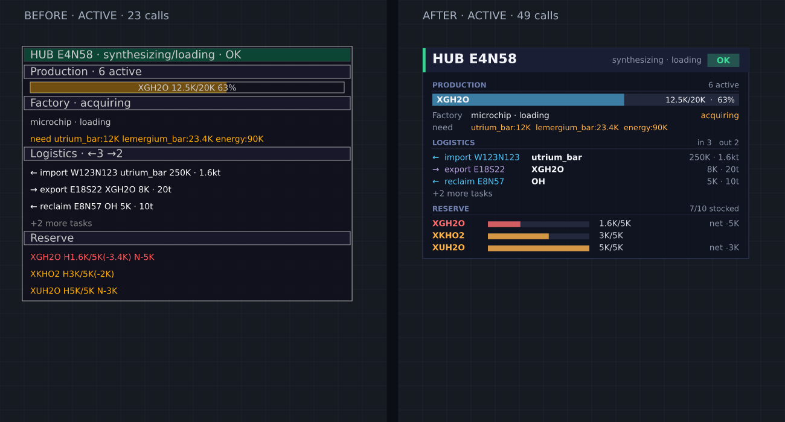

# Hub 面板美化补丁验证

日期：2026-10-17（Asia/Shanghai）。基于 `79002475` 应用用户提供的 `hub-panel-美化.patch`，工作分支为 `codex/hub-panel-20261017`。

## 改动

- 新增缓冲绘图的 `Card`，按实际内容计算背景高度；标题栏、健康徽标、警告区及生产/物流/储备分区统一排版。
- 物流使用方向颜色与对齐列；储备使用行内进度条；工厂展示产品、阶段、状态及缺料。
- 统一主面板与卫星面板的配色，调整旧 `Panel` 的底色及进度条透明度。
- 按补丁将总绘图预算从 80 提到 100 次，保留卫星面板最多 6 个和阻塞房间优先策略。
- 保留此前的默认关闭、默认 bucket 至少 8,000 及到期停止逻辑；生产、物流和库存决策保持原实现。

补丁原版将工厂状态和最多三项缺料放在同一行。实际绘图操作生成的离线预览检出该行与产品/阶段重叠，现将缺料独立成行，同时保留状态列。新增绘图组件的说明注释使用中文。

## 离线视觉检查

使用当前绘图函数捕获实际 `rect/text` 指令，以相同输入分别绘制基线与候选。字体为 DejaVu Sans；预览用于排版检查，不是游戏内截图。三种合成状态已人工查看，并以渲染器的文字边界检测同卡片重叠和横向越界，最终均未发现问题。

| 主面板场景 | 基线绘图调用 | 候选绘图调用 |
| --- | ---: | ---: |
| 空闲、储备已满 | 12 | 19 |
| 生产、多项工厂缺料、物流及储备缺口 | 23 | 49 |
| 阻塞、告警、任务阻塞及缺料 | 24 | 51 |

以上是主面板实际调用数，卫星面板额外计入总预算。美化增加了绘图调用，现有开关和 bucket 门控继续生效；未测量线上 CPU。

另见[空闲状态](./2026-10-17-hub-panel/idle.png)、[阻塞状态](./2026-10-17-hub-panel/blocked.png)。

## 验证

构建、类型检查、测试和图片渲染均在服务器独立任务目录完成。本机仅编辑、传输和查看结果。

| 检查 | 结果 |
| --- | --- |
| 生产 strict 与测试类型检查 | 两份配置通过 |
| Hub 进度、Hub 工厂、Panel、palette 定向回归 | 4 套件、25 用例通过，零失败/pending/todo |
| 构建 | 通过；运行时模块合计 4,626,337 字节，0 个循环依赖告警 |
| 源码一致性 | 631 项源码及配置逐一比对；运行前后与本机源码均一致 |
| 视觉排版 | 三种状态无检出的文字重叠或横向越界；工厂三项缺料已换行 |

本次验证范围为上述定向回归，未重新执行整套项目回归。临时预览捕获源码位于忽略目录并以 `.txt` 归档，服务器执行完即移除临时模块。完整日志与源码清单位于工作树的 `monitor-data/hub-panel-20261017/evidence/`。

本轮未上传代码、修改线上配置或开启面板。服务器构建使用隔离验证身份，不能当作正式发布身份。

机器可读汇总见[验证摘要](./2026-10-17-hub-panel/summary.json)。
